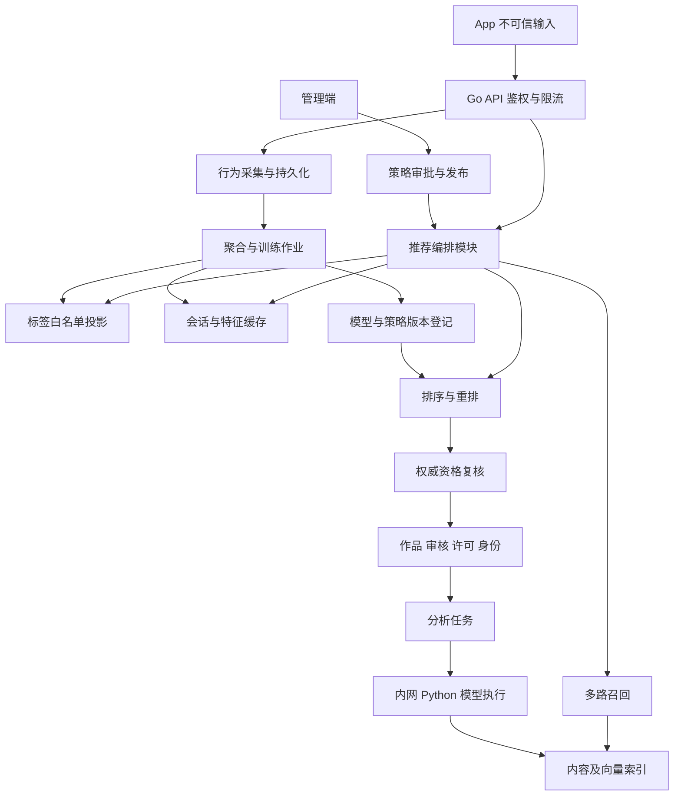
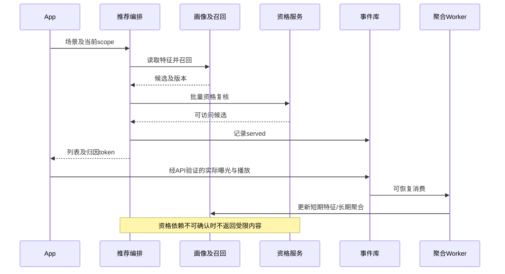
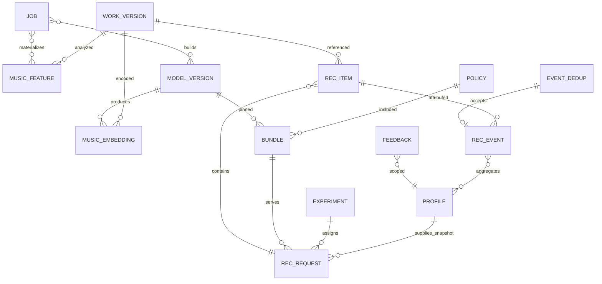
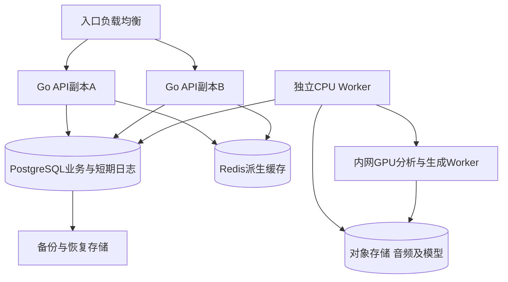

# SonicHub 音乐推荐系统业务架构与技术架构

| 项目 | 内容 |
|---|---|
| 版本 | V1.0 · 2026-11-17 |
| 状态 | 设计提案，待产品、研发、算法、合规评审；不是已实施说明 |
| 范围 | 音乐消费推荐、创作灵感推荐、企业配乐推荐，与客户标签系统衔接 |
| 面向读者 | 产品、Go 后端、模型研发、客户端、管理端、测试及运维 |
| 基线 | [客户标签架构](file:///D:/githubProject/MusicProduct/deliverables/customer-tag-system-architecture.md) |
| 责任假设 | 产品负责场景与指标；后端负责在线推荐与数据契约；算法负责音乐理解和评估；运营负责策略；合规负责用途与许可 |

证据约定：`[已核对]` 表示本次静态代码或既有文档事实，不表示运行验证；`[设计建议]` 表示目标方案；`[待验证假设]` 表示容量、效果、政策或模型能力尚待验证。除现状章节外，本文模块、表、接口、阈值均为设计建议，数值目标不代表压测或线上收益。

## 1 架构决策与业务边界

### 1.1 决策摘要

[设计建议] 在线推荐采用现有 Go 模块化单体内的独立推荐模块，音乐理解、向量生成、模型训练和音乐生成采用异步 Python 作业。推荐链路为“请求上下文 → 画像与会话特征 → 多路召回 → 安全过滤 → 排序 → 多样性重排 → 最终权限复核 → 返回 → 真实曝光与播放反馈”。

| 驱动力 | 对设计的影响 |
|---|---|
| 已有用户、作品、积分、审核和 feed 能力 | 复用事实源与鉴权，不另建一套内容主数据 |
| 新用户和新 AI 音乐缺少互动历史 | 使用可解释标签匹配作为起点，逐步增加音频语义召回 |
| 生成耗时远大于推荐请求 | 浏览推荐不触发付费生成，GPU 不能成为首页同步依赖 |
| 个人听歌与企业创作意图不同 | 分场景画像、分租户范围和分目标排序 |
| 版权及私有作品风险高 | 权限与许可是硬过滤条件，任何加权和保底都不能绕过 |

拒绝的初始方案：全量微服务增加分布式治理成本，当前没有独立扩容证据；逐请求让大模型生成整份推荐列表增加时延、成本和不可复现性；继续只用热榜无法覆盖冷启动和个性化目标。

正向结果：保留稳定基线，可逐步接入模型，策略可解释。负向结果：新增事件、特征、索引和版本治理；在线服务与业务数据库仍共享故障域，必须限制后台作业资源。

可逆性：推荐编排与排序策略易替换；埋点语义、主体隔离和许可记录迁移成本高，应先评审。若独立扩容、故障隔离或模型发布节奏成为瓶颈，再拆在线推荐服务。责任人为后端负责人（岗位假设）。

### 1.2 目标与非目标

| 目标编号 | 业务目标 | 对应能力 | 主指标 |
|---|---|---|---|
| G1 | 新用户快速找到愿意听的音乐 | 冷启动偏好与多样化探索 | 新用户有效播放率、D7 留存 |
| G2 | 老用户持续发现合适作品 | 长短期兴趣、相似音乐、序列特征 | 用户级有效收听时长、收藏率 |
| G3 | 听歌自然转为创作 | 灵感模板、参数建议、可授权参考曲 | 推荐带来的成功首作率 |
| G4 | 新作品获得合理试探流量 | 内容特征与分层探索 | 新作有效曝光覆盖率、满意度 |
| G5 | 企业成员找到能用的配乐 | 用途匹配与商用许可过滤 | 合法素材采用率 |
| G6 | 推荐可治理、可回退 | 版本、实验、解释、审计与降级 | 安全违规率、推荐可用性 |

[设计建议] 不包含广告竞价、个体差别定价、完整版权确权平台或无点击自动生成无限音乐。推荐系统不修改账户余额、会员权益、封禁状态或作品授权。标签系统仍负责画像治理与圈选，实时排序归推荐模块。

### 1.3 推荐对象与用户角色

| 对象 | 使用场景 | 资格来源 |
|---|---|---|
| 已发布音乐作品的可播放版本 | 首页、相似歌曲、连续播放 | 作品状态、审核状态、播放授权 |
| 创作模板 | 新手引导、灵感页 | 模板审批、可用模型能力与参数范围 |
| 可参考的音乐及参数摘要 | 听后创作、续作灵感 | 独立的参考/改编许可，不等同播放许可 |
| 企业素材 | 商业视频、广告、游戏配乐 | 当前租户成员权限及具体用途许可 |

C 端听众、个人创作者、企业成员、运营人员和算法人员使用不同权限入口。推荐素材对象与公开作品对象通过 `item_type` 区分，不能把模板点击当作品播放。

## 2 现有系统与新增能力

### 2.1 代码核对结果

| 范围 | 已核对事实 | 设计影响 |
|---|---|---|
| 推荐入口 | [handlers_content.go](file:///D:/githubProject/MusicProduct/SonicHub_api/internal/api/handlers_content.go#L374-L417) 直接查询热榜，关注信息影响理由，首页可补保底 | 保留 handler 外部兼容层，新增推荐编排接口 |
| 排序与过滤 | [works.go](file:///D:/githubProject/MusicProduct/SonicHub_api/internal/store/works.go#L99-L155) 有发布、可见性、拉黑、反馈和运营名单过滤，固定热度公式 | 热榜可作为对照组；已有过滤要形成统一资格服务 |
| 策略配置 | [admin.go](file:///D:/githubProject/MusicProduct/SonicHub_api/internal/store/admin.go#L298-L343) 可保存权重和多样性配置 | 配置存在不代表主链路应用，必须加策略执行与效果追踪 |
| 行为 | [extra.go](file:///D:/githubProject/MusicProduct/SonicHub_api/internal/store/extra.go#L84-L88) 写反馈；[works.go](file:///D:/githubProject/MusicProduct/SonicHub_api/internal/store/works.go#L301-L304) 累加播放 | 无法直接据此构造真实播放序列或完播训练标签 |
| 曝光 | [001_init.sql](file:///D:/githubProject/MusicProduct/SonicHub_api/migrations/001_init.sql#L318-L345) 有曝光表定义，静态检索未发现写入链路 | 第一阶段必须建设客户端曝光与服务端校验 |
| 音乐生成 | [server.py](file:///D:/githubProject/bigMusicModel/web/server.py#L301-L353) 有歌词、生成和进度接口 | 仅作为异步生成能力；运行状态和权重加载未验证 |
| 音频特征 | [condition_encoder.py](file:///D:/githubProject/bigMusicModel/music_llm/l3_generation/condition_encoder.py#L112-L166) 为轻量音高/频谱特征 | 不宣称具有通用音乐语义 embedding |
| 推荐实验 | [features.py](file:///D:/githubProject/bigMusicModel/music_llm/recommendation/features.py#L61-L87)、[recall.py](file:///D:/githubProject/bigMusicModel/music_llm/recommendation/recall.py#L19-L62)、[rank.py](file:///D:/githubProject/bigMusicModel/music_llm/recommendation/rank.py#L23-L70) 使用标签哈希、固定随机投影和位置衰减 | 可用于实验接口验证，不能命名为已训练双塔或 SASRec |

[已核对] 当前技术基线为 Go、go-zero、pgx 与 PostgreSQL。本文没有验证数据库是否迁移、模型服务是否可达或实际性能。

### 2.2 对客户标签架构的兼容与修正

1. 延续 `user / tenant / member` 主体划分。成员推荐画像必须以 `(tenant_id, user_id)` 或不可变 membership ID 标识，禁止仅以 user ID 存企业兴趣。
2. 标签文档中的“曝光数据存在”只能解释为表结构存在；可靠曝光采集仍需建设。Outbox 是否完整实施尚待核验，不能作为既成依赖。
3. 不沿用“人工 > 模型 > 规则 > 事实”的跨来源全局覆盖。权威事实不得被模型或运营覆盖；兴趣预测、用户显式偏好、运营标记分别存储，排序时按用途合成。
4. 标签命名当前限定域中没有 `listening`，本文新增听歌域须先更新标签域登记；未审批前不能直接发布编码。
5. 人群位图用于策略分组或运营触达，不作为音乐向量索引，也不在每次推荐请求现场执行复杂圈选。Redis 原生位图与 Roaring 编码实现应单独选型，不假设普通 Redis 自带 Roaring 能力。
6. 标签下线保留审计与用户删除权需要协调：可保留无个人身份的治理记录，个人标签值和关联关系按删除策略清理，禁止以“不可变历史”为由无限保留。

## 3 业务场景设计

所有示例人物和指标数值仅用于说明，不代表真实用户。推荐请求不得因用户余额不足阻断免费听歌。

### R1 新用户首次进入首页

小林从短视频入口注册，选择“国风、轻音乐、通勤”。系统记录用户明确选择，允许跳过，不使用渠道推断收入或敏感属性。

- 输入：`user.lifecycle.stage`、显式听歌偏好、语言、当前场景；创作引导是否完成仅决定引导卡，不替代听歌兴趣。
- 召回：偏好风格池、当前合规热榜、新作探索池。初始比例建议 50% / 35% / 15%，按候选量调整并版本化。
- 页面：提供“为你推荐”“换一种风格”“不感兴趣”；创作引导独立卡位，不混入歌曲排序指标。
- 反馈：有效播放提高当前会话兴趣，连续快速切歌降低相似候选，用户主动改偏好立即生效。
- 边界：跳过偏好或关闭个性化时返回按语言和场景组织的通用榜单；匿名用户仅保留有期限的匿名会话，不跨设备强行拼接。
- 验收：可解释为何出现；无画像也有可播放结果；分别统计有效播放率与注册后7日成功首作率。

### R2 老用户首页与连续播放

苏野长期听电子乐，但晚上连续听了三首钢琴曲。首页保留长期电子偏好，当前连续播放队列提高钢琴和低能量曲目占比。

- 输入：新建 `user.listening.genre_pref`、`user.listening.vocal_pref`，最近会话播放序列与当前 seed 音乐；`user.creation.style_pref` 只能做弱辅助。
- 召回：长期偏好、会话相似、协同候选、关注作者、新作探索。
- 排序：有效收听、收藏预估及质量特征；首页与连续播放使用独立策略。
- 反馈：主动切歌、播放错误、网络中断分别记录；后两者不作不喜欢信号。
- 边界：用户拒绝某作者后立即过滤该作者，不等待离线画像更新；撤销后解除屏蔽，但不补造正反馈。
- 验收：同一用户在不同会话可获得不同队列；作者限频和同曲不同版本去重有效。

### R3 听到喜欢的歌曲后创作同类作品

用户听完一首国风配乐，点击“用类似风格创作”。推荐提供经授权的风格、速度区间和乐器组合，不复制原歌词、旋律或音色身份。

- 输入：当前歌曲的已审核音乐标签、参考许可、`user.creation.style_pref`、`user.creation.duration_pref`、新手状态。
- 动作：展示3个可编辑模板，标注预估积分、参考用途限制和生成能力；参数由用户确认。
- 交易：点击生成后由原生成模块完成报价、权限校验、积分冻结、异步任务和结算。推荐只传 `recommendation_request_id` 与模板版本用于归因。
- 失败：模型不可用或能力不支持时禁用对应模板；积分不足由计费流程提示，不在推荐侧用付费倾向提高价格。
- 验收：仅浏览和点击模板不扣费；成功生成以服务端任务终态计数；7日首作归因不能只算生成按钮点击。

### R4 新生成音乐的冷启动分发

创作者发布一首没有播放历史的新歌。发布并审核通过后触发音频分析，内容符合准入条件才进入探索候选池。

- 输入：作品风格、情绪、乐器、速度、音频质量、作者分层和历史可信质量。创作者等级只做受限辅助，不能变成永久头部特权。
- 流程：内容标签匹配人群 → 小批探索 → 达到最低有效样本 → 比较同类曲目的完播、收藏和负反馈 → 扩大或收缩分发。
- 初始试探预算：每首100次有效曝光作为待验证起点；按风格、时长与用户数分层，不向同一用户重复刷量。
- 边界：未达样本门槛不把“零收藏”解释为差作品；置信区间过宽时保持探索；疑似刷量事件隔离，不直接永久封禁作者。
- 验收：新作覆盖率与用户满意度共同监测，不能仅用曝光量证明算法有效。

### R5 沉默用户回访与召回

陈默30日未访问，历史收藏影视配乐。消息中心按标签人群快照、订阅授权和频控决定是否触达；推荐只提供当时可访问的新作品集合。

- 输入：`user.lifecycle.stage = dormant`、历史非敏感兴趣、`user.service.recall_sensitivity` 仅供触达策略使用。
- 动作：召回落地页展示近期相关新作与用户仍拥有的未完成项目；私有项目链接必须重新鉴权。
- 边界：运营人群快照固定分组，但每次发送仍检查退订、账号状态，每次打开仍检查内容权限；过期画像降低权重。
- 验收：回访后7日有效收听/二次创作、退订率和投诉率；使用随机不触达对照组测量增量。

### R6 企业短视频商用配乐

SonicLab 的成员需要“30秒、无歌词、轻快、可商用”的产品视频配乐。

- 输入：当前租户与成员身份、显式用途、时长范围、语言/人声要求；租户历史采用风格可辅助，但租户流失风险和消费能力不得进入排序。
- 召回：具备对应许可的公共作品＋当前租户授权素材；企业私有素材索引单独分区。
- 排序：用途适配、节奏与剪辑长度、人工采用反馈，不以停留时长为唯一目标。
- 边界：播放许可、下载许可、商业使用许可、改编许可分别校验；企业套餐标签不能证明单首作品商用授权。
- 验收：其他租户任何私有标题、向量结果、推荐理由和下载地址均不泄漏；下载签发前再次校验许可证状态。

### R7 自然语言找音乐与相似音乐

用户输入“雨夜开车、无人声、有一点爵士但别太伤感”，或在合法访问的歌曲上点“更多类似”。

- 结构化解析将文本映射为场景、风格、人声、情绪强度及排除条件；先用受限字典和标签检索实现，再评估文本—音频共同向量空间。
- 查询向量与歌曲向量必须属于同一 embedding space；任意文本模型和音频模型输出不能直接比较。
- 无成熟语义模型时返回标签匹配并说明可调整条件；不得伪装成音频语义理解。无候选时提示放宽软条件，不能放宽授权和内容安全。
- 验收：明确“无人声”作为硬需求时，未知人声状态的作品不能冒充符合；展示匹配依据，不输出原始敏感画像。

### R8 个性化关闭与保护性推荐

用户关闭个性化、清空兴趣或启用保护模式。推荐从后续请求停止使用个体画像和历史序列，改用允许的非个性化内容集合。

- 同意版本变化使画像缓存和个性化列表缓存失效；清空兴趣创建删除任务，明确是否同时删除历史行为。
- 年龄/未成年状态仅由身份保护服务输出内容资格约束，不作为提高停留或付费转化的排序特征。
- 验收：关闭个性化后请求日志标识 `personalization=off`，实际特征读集无个人兴趣和付费标签；保护约束不可被运营白名单覆盖。

## 4 客户标签与音乐标签协同

### 4.1 三类特征的职责

| 层 | 所属模块 | 内容 | 更新方式 |
|---|---|---|---|
| 治理型客户标签 | Tag | 生命周期、创作偏好、长期听歌偏好、来源与有效期 | 事件、小时或日批 |
| 推荐特征 | Recommendation | 当前会话、曝光次数、短期兴趣向量、行为窗口统计 | 秒级会话更新或批量物化 |
| 音乐内容特征 | Music Understanding | 风格、乐器、情绪、BPM、人声、语义向量、质量 | 发布后异步分析，版本变化重算 |

不把每个浮点向量维度或每秒变化的计数注册成业务标签。长期偏好可聚合回标签系统，但须走版本治理，原始会话序列留在推荐特征域。

### 4.2 标签消费合同

[设计建议] 推荐通过模块接口 `GetRecommendationProfile(scope, purpose, asOf)` 获取最小白名单投影，不直接读取标签全表，也不调用敏感画像管理接口。

```json
{
  "scope": {"subject_type": "user", "subject_id": "u_1024", "tenant_id": null},
  "purpose": "music_personalization",
  "profile_version": "pv_42",
  "consent_version": "cv_8",
  "as_of": "2026-11-17T02:00:00Z",
  "tags": [{
    "code": "user.creation.style_pref",
    "value": ["guofeng"],
    "confidence": 0.81,
    "definition_version": "v3",
    "source": "rule",
    "updated_at": "2026-11-16T22:00:00Z",
    "expires_at": "2026-11-23T22:00:00Z",
    "stale": false
  }]
}
```

规则：类型、代码、版本未知时忽略该标签并计数；过期标签不得参与正式策略；`stale` 的非敏感偏好仅在已审批宽限期内衰减使用；当前显式条件优先于预测偏好。隐私授权、权限、审核和风险资格不得用过期快照替代。

### 4.3 标签使用矩阵

| 标签 | 首页听歌 | 创作推荐 | 企业推荐 | 限制 |
|---|---|---|---|---|
| `user.lifecycle.stage` | 冷启动/回访策略分组 | 引导策略 | 不继承个人阶段 | 不向其他用户暴露 |
| `user.creation.style_pref` | 可控弱特征 | 主要偏好 | 仅用户明确允许时辅助 | 创作不等于爱听 |
| `user.creation.duration_pref` / `vocal_pref` | 不直接推断 | 模板参数 | 当前企业项目条件优先 | 缺失使用中性默认 |
| `user.creation.creator_tier` | 候选作者探索策略 | 创作引导 | 不作为企业授权 | 不保证固定流量 |
| 新增 `user.listening.genre_pref` / `vocal_pref` | 长期偏好 | 辅助 | 默认隔离 | 需先登记 listening 域 |
| 新增 `member.creation.style_pref` | 不使用 | 不用于个人 | 企业内偏好 | 键包含 tenant_id |
| `user.billing.*` / `tenant.health.*` | 禁用 | 不作音乐排序特征 | 禁用 | 由独立经营模块按许可使用 |
| `user.risk.*` | 不作兴趣特征 | 不作兴趣特征 | 不作兴趣特征 | 只消费权威风控资格决定 |
| 年龄等敏感保护属性 | 不进入优化特征 | 不进入营销特征 | 按权限输出限制 | 仅保护服务提供允许范围 |

### 4.4 音乐标签体系

| 维度 | 示例 | 数据来源及不确定性 |
|---|---|---|
| 风格与子风格 | 国风、爵士、电子、Lo-fi | 生成参数仅为声明，需音频分析或人工确认 |
| 情绪与能量 | 平静、明亮、紧张；energy 0–1 | 模型推断，带置信度，不能推断听众心理健康 |
| 声学结构 | BPM、拍号、调性、段落、时长 | DSP/模型结果；BPM 倍频、调性歧义需保留候选 |
| 人声与语言 | 纯器乐、中文演唱 | 模型与人工审核；未知状态明确表示 |
| 乐器与编制 | 钢琴、古筝、弦乐、合成器 | 多标签及置信度 |
| 使用场景 | 通勤、学习、游戏、广告 | 用途匹配标签，不代表授权 |
| 质量 | 削波率、静音占比、响度、异常结束 | 客观检测与主观抽检并行 |
| 许可与安全 | 公开播放、商业用途、参考改编 | 权威版权/审核系统，禁止模型推断替代 |

内容身份采用 `work_id + version_id + audio_hash`；同一作品重新生成/替换音轨必须生成新分析版本。标签提取的输入摘要、模型版本、任务 ID 与人工修正均留痕。

## 5 音乐大模型的职责与演进

### 5.1 能力分层

| 能力 | 在系统中的作用 | 当前判断 | 新增要求 |
|---|---|---|---|
| 音乐生成 | 用户确认后生成作品 | 有本地生成路径，服务和许可需验证 | 与现有报价、冻结、异步任务对接 |
| 音乐理解 | 提取实际音频风格、情绪、人声等 | 现有 DSP 不能覆盖语义理解 | 选择模型并用中文/国风/长短曲集评测 |
| 音频语义向量 | 相似音乐召回、新作冷启动 | 现有随机投影不构成训练后语义空间 | 统一预处理、维度、归一化和距离规范 |
| 文本—音频对齐 | 自然语言找音乐 | 未验证存在 | 配对训练或评测合格的共同空间 |
| 用户/作品双塔 | 大规模个性化召回 | 未验证存在 | 真实曝光与播放样本、负采样、检索评估 |
| 序列排序 | 连续播放与短期意图 | 现有位置衰减不是 Transformer | 数据量足够且优于基线才引入 |

[设计建议] 不承诺用同一个音乐生成模型同时完成高质量语义理解和推荐。生成权重、音频编码器、排序模型独立版本和许可治理。

### 5.2 异步分析流程

图1 音乐发布与特征物化


图中分析失败不应导致已有合格作品不可播放。可先使用经过核准的元数据参与标签召回，语义通道暂不收录。任务键为 `(version_id, audio_hash, pipeline_version)`，重试不覆盖其他版本结果；以状态 `queued/running/succeeded/failed/cancelled` 管理，租约超时可恢复。

安全要求：音频来源必须是受控对象存储 key，不让模型端抓取任意用户 URL；限制时长、解码资源和文件大小。提示词、歌词均为不可信内容，不可改变系统指令或执行工具。

### 5.3 向量空间与版本切换

一个 `embedding_space_id` 固定模型权重摘要、音频采样率、分段方式、池化、归一化、维度与距离函数。不同空间不能相加或比较。

新空间发布采用“离线全量构建 → 完整性与检索评估 → shadow 查询 → 小流量实验 → 原子发布绑定索引的bundle”。策略bundle必须同时绑定space_id、对应查询编码器版本和不可变index_build_id（或空间专用索引引用）；请求开始后固定这些引用，不能在处理中重新解析共享别名。灰度与旧cursor继续使用各自bundle，发布及回退切换整组映射，禁止独立切换共享索引造成混空间。旧索引保留到回退及有效cursor窗口结束。长曲多片段编码可聚合为曲级向量，片段召回按 `work_id` 合并，避免长曲因片段多获得额外曝光。

## 6 技术架构与模块边界

图2 逻辑架构与信任边界



客户端提交的用户、租户、计费结果均不可信，API 从认证上下文取身份。模型服务仅内网访问，没有修改账户和审核的权限。推荐模块读取资格决定，不能通过修改标签放行内容。

### 6.1 领域上下文映射

| 上下文 | 责任岗位假设 | 所有模型 | 上游及关系 | 下游及关系/翻译面 |
|---|---|---|---|---|
| Identity/Consent | 账号后端 | 身份、成员、同意版本 | 用户设置 | 推荐为客户，接收 scope 和允许用途，不复制 RBAC |
| Content/Moderation/Rights | 内容后端 | 作品版本、审核、许可 | 创作与版权资料 | 推荐遵从资格决定，将作品翻译成候选摘要 |
| Tag | 数据研发 | 标签定义、赋值、人群快照 | 行为/业务事实，只读客户关系 | 推荐通过防腐层映射到白名单特征 |
| Recommendation | 推荐后端 | 请求、候选、排序策略、反馈 | 身份、标签、内容供应方 | App 消费排序结果；生成消费归因，不接受权限指令 |
| Music Understanding | 模型研发 | 分析任务、音乐标签、向量 | 合法音频与版本 | 推荐通过版本契约消费特征，不依赖模型内部类 |
| Generation/Billing | 创作及计费后端 | 任务、报价、冻结、账本 | 用户明确提交 | 推荐仅读成功/失败及归因事件，禁止反向写资金 |
| Messaging | 增长后端 | 触达任务、退订、频控 | 标签快照与推荐候选 | App 落地页；推荐不代替触达授权 |
| Experiment/Operations | 产品与算法 | 实验、策略、批准记录 | 聚合指标 | 推荐遵从已发布清单，不接受任意脚本 |

### 6.2 建议模块划分

```text
internal/recommendation/
  domain/       Candidate、Scope、PolicyBundle、接口与不变量
  app/          Recommend、RecordEvents、Feedback、PublishPolicy
  recall/       热榜、标签、相似、协同、关注、探索
  rank/         规则评分、模型适配、多样性重排
  infra/        pgx仓储、缓存、索引、模型客户端
  transport/    App/Admin handler、事件适配
```

这是建议目录，不表示已创建。依赖方向为 `transport → app → domain`，基础设施实现 domain 接口。原 handler 先委托 app；不在 handler 拼接多个 SQL 或模型调用。音乐分析 Worker 与在线 API 使用独立并发、数据库连接池和资源预算。

### 6.3 核心内部合同

| 接口 | 输入 | 输出 | 不负责 |
|---|---|---|---|
| `ProfileProvider.Get` | 已鉴权 scope、purpose、as_of | 标签白名单、版本、缺失状态 | 全量客户360 |
| `RecallChannel.Recall` | 上下文、特征、limit、deadline | 候选ID、版本、通道、原始分 | 最终授权 |
| `Eligibility.CheckBatch` | scope、候选、action、时间 | allowed、不可外泄的拒绝原因、事实版本 | 个性化排序 |
| `Ranker.Score` | 已过滤候选、特征快照、模型版本 | 分值及受控贡献摘要 | 调用生成或扣费 |
| `Reranker.Select` | 排序结果、多样性规则、已曝光集合 | 最终有序列表 | 放宽安全限制 |
| `PolicyRegistry.Resolve` | 场景、服务端实验分组 | 不可变策略清单 | 接受客户端强制实验组 |

## 7 在线推荐算法

### 7.1 请求阶段与候选规模

[待验证假设] 每次返回20项，单路召回不超过200，去重后不超过600，规则粗排保留200，精排后重排20。初期无学习模型时直接规则排序，避免假装“精排模型”已上线。

1. 校验场景、当前 scope、个性化同意和 cursor。
2. 并行读取允许画像、会话特征、不可变策略清单。
3. 多路并行召回，单通道失败不阻断其他通道。
4. 以作品族/音频哈希去重，合并召回来源；预过滤状态和权限。
5. 粗排、可选模型排序、多样性重排。
6. 对最终候选执行权威资格批量复核；不足则从剩余合格候选补齐。
7. 写服务端下发记录，返回带短期归因 token 的候选。下发不是曝光。

### 7.2 召回通道

| 通道 | 候选来源 | 价值 | 失败替代 |
|---|---|---|---|
| 合规热榜 | 时间衰减的聚合指标 | 无画像稳定供给 | 已审核运营池 |
| 标签匹配 | 听歌/创作偏好与音乐标签倒排 | 冷启动、解释性 | 热榜 |
| 音频相似 | seed 或已授权兴趣向量 | 相似歌曲、新作品 | 标签匹配 |
| 协同 Item-to-Item | 共同有效听歌/收藏 | 群体行为发现 | 音频/标签 |
| 关注作者 | 关系与公开新作 | 订阅兴趣 | 非关注通道 |
| 会话兴趣 | 最近有效行为 | 快速意图变化 | 长期兴趣 |
| 新作探索 | 合格且低曝光作品 | 供给公平与学习 | 不强行填充 |
| 企业用途 | 范围与授权过滤后的素材 | 可用性与隔离 | 当前租户合法运营素材 |

不同通道分数尺度不可直接求和。规则阶段可使用 Reciprocal Rank Fusion 或按通道分位数归一化，参数随策略版本记录；个性化模型阶段将通道特征输入统一排序模型。

### 7.3 初始规则评分

以下公式仅为设计起点，所有连续特征缩放到0–1：

```text
score = 0.35 * interest_match
      + 0.20 * session_match
      + 0.15 * quality
      + 0.10 * freshness
      + 0.10 * trusted_popularity
      + 0.10 * exploration_bonus
      - 0.30 * repetition_penalty
```

没有会话数据时，将可用正向权重重新归一化，不能把缺失等同低质量。`interest_match` 应区分显式偏好、实际听歌和创作偏好，当前明确条件优先。权重不来自付费能力、风控概率或敏感心理推断。

### 7.4 学习排序演进

- 首先建立时间衰减规则与协同基线；数据足够后比较逻辑回归/树模型，不直接上复杂序列模型。
- 多任务目标可包括有效播放概率、时长归一化收听比、收藏概率、快速跳过概率；创作模板另建成功生成/采用目标。
- 收听时长必须截尾并按作品长度归一化，防止天然偏向长曲。商业采用由下载后确认或项目采用行为衡量，不能用点击替代。
- 用户兴趣向量由合法有效行为的作品向量做时间衰减聚合，负反馈通过排除和降权处理；缺失向量不参与算术。
- 反馈只对产生行为的场景更新：企业配乐采用不写入个人夜间听歌偏好。

### 7.5 重排规则与解释

[待验证假设] 首页前20首同作者最多2首、同作品族最多1首、新作探索约10%、相邻不连续3首同子风格；相似音乐场景不强求跨风格比例。软配额冲突时可放宽多样性，硬权限、未成年人保护和不喜欢作者约束永不放宽。

推荐理由使用白名单模板：`“与你最近收藏的国风配乐相近”`、`“匹配无歌词和轻快节奏”`、`“你关注的作者有新作品”`。返回可验证原因码及证据版本，不返回风险等级、消费能力或模型自由编写的敏感解释。

## 8 行为采集与数据可靠性

### 8.1 事件语义

| 事件 | 触发条件建议 | 统计用途 |
|---|---|---|
| `recommendation.served` | 服务端返回候选 | 供给诊断，不计曝光 |
| `item.impression` | 卡片可见面积≥50%且持续≥1秒 | 曝光分母；阈值版本化 |
| `play.started` | 实际开始输出音频 | 起播及失败分析 |
| `play.progress` | 播放心跳，前台/后台合法播放均可 | 服务端重建有效时长 |
| `play.ended` | 自然结束、主动停止、跳过、错误分类 | 完播、早跳过、质量 |
| `item.like/collect/share` | 服务端确认操作成功 | 偏好正反馈 |
| `recommendation.feedback` | 不喜欢作品/作者、撤销 | 即时过滤与训练标签 |
| `creation.started/completed` | 原生成服务权威事件 | 模板转化归因 |
| `asset.adopted` | 企业项目确认采用 | 企业推荐结果 |

[待验证假设] 有效播放初始口径为 `active_play_ms >= min(30000, duration_ms * 0.5)`，eligible 曲目时长至少10秒；超短提示音单独分层。完播率以有效听完≥90%为起点，循环不无限累加。有效曝光、有效播放和完播是不同指标。

### 8.2 事件结构与校验

```json
{
  "event_id": "ev_uuid",
  "schema_version": 1,
  "event_type": "play.progress",
  "request_id": "rec_uuid",
  "impression_id": "imp_uuid",
  "play_session_id": "ps_uuid",
  "sequence": 3,
  "item_id": "work_123",
  "version_id": "version_8",
  "occurred_at": "2026-11-17T02:10:00Z",
  "position_ms": 24000,
  "delta_play_ms": 10000,
  "reason": null,
  "attribution_token": "server_signed_token"
}
```

身份与租户由服务端写入，不能信任客户端传值。token 绑定 scope、request、item、版本、有效期和实验组；同时校验上报 item 与下发记录匹配。进度增量受服务端时钟、持续时长、序号和最大速率约束，seek、静音、重复、离线补传分别标记。

#### 曝光身份与来源约束

客户端在一次卡片展示实例首次达到有效曝光阈值时生成 `impression_id`（UUID），心跳、重试与同次展示复用该ID；离开后重新进入可生成新ID，但指标另按 `(scope, request_id, item_id)` 去重，避免来回滚动刷分母。播放引用触发该播放的曝光ID；连续播放或曝光阈值前点击可以没有有效曝光，单独统计起播，不凭空补曝光或纳入曝光转化分子。

推荐来源要求 request_id、item/version及有效归因token，impression事件还要求impression_id；非推荐来源必须标记 `source=direct/search/library`，不传伪造request或token，通过原播放授权记录验证item与scope，进入非推荐指标。推荐播放的impression_id允许为空，但其归因request/token仍必填。服务端生成事件必须来自业务模块，客户端无权确认交易或生成终态。

### 8.3 幂等、乱序与归因

- 网络重传保持同一个 `event_id`；原始事件去重后再更新聚合。播放心跳按 `(play_session_id, sequence)` 去重，重叠区间不能重复累加。
- 分区事件表使用包含分区键的唯一约束；跨分区去重由独立短期 dedup 表承担，不能假定分区表支持仅 event_id 全局唯一。
- 原始事件与消费任务登记同事务提交，消费者提交聚合及 checkpoint 后确认；至少一次传递配合幂等，不声称端到端 exactly-once。
- 允许迟到24小时作为初始口径，按事件时间重算窗口；客户端未来时间超过5分钟隔离。迟到范围和保存期限需评审。
- 播放直接绑定下发归因；成功创作通过原生成任务保存归因 ID。推荐点击归因窗口建议24小时，留存使用随机分组评估，不宣称最后点击就是因果。
- 曝光与转化使用共同版本维度，不能把上一模型的曝光和新模型的行为拼成同一训练样本。

图3 推荐请求与行为回流



该流程将服务端下发、客户端真实可见和真实收听分开。App 不能直接访问事件数据库，图中的上报经过 API 鉴权、校验与限流。

## 9 数据模型与索引

### 9.1 主要实体

以下均为逻辑设计，实际迁移须核对原表字段后增量调整，不重复创建现有 feed 表。

| 实体 | 关键字段及类型 | 主键/约束与用途 |
|---|---|---|
| `music_features` | version_id text、audio_hash text、pipeline_version text、tags jsonb、quality jsonb、status text、analyzed_at timestamptz | 联合唯一(version_id,audio_hash,pipeline_version)，标签带来源与置信度 |
| `music_embeddings` | version_id text、space_id text、vector、checksum text、status text | 联合主键(version_id,space_id)，维度与空间一致 |
| `recommendation_profiles` | scope_key text、purpose text、feature_version text、features jsonb、as_of/expires_at timestamptz、consent_version text | 唯一(scope_key,purpose,feature_version)，不复制权限 |
| `recommendation_requests` | request_id uuid、scope_key text、scene text、bundle_id text、experiment jsonb、feature_snapshot_id text、degrade_level text、created_at timestamptz | 请求主键；只保存允许的特征摘要或引用 |
| `recommendation_items` | request_id uuid、position int、item_type text、item_id/version_id text、channels jsonb、reason_code text | 主键(request_id,position)，用于归因和重放 |
| `recommendation_events` | event_day date、event_id uuid、type text、request_id uuid、scope_key text、occurred_at/received_at timestamptz、payload jsonb | 日期分区；同分区唯一(event_day,event_id) |
| `recommendation_event_dedup` | event_id uuid、received_at timestamptz | event_id主键，有效期覆盖允许重传窗口 |
| `recommendation_feedback` | scope_key text、target_type/id text、kind text、status text、version bigint、updated_at timestamptz | 唯一(scope_key,target_type,target_id,kind)，撤销追加历史 |
| `recommendation_policies` | id uuid、scene text、version text、config jsonb、status text、approved_by text | 唯一(scene,version)，active指针原子切换 |
| `recommendation_bundles` | id uuid、policy_id uuid、rank_model_id text、space_id text、query_encoder_version text、index_build_id text、feature_schema text、reason_version text | 不可变兼容性清单，禁止任意混版本 |
| `recommendation_experiments` | id uuid、unit text、salt text、variants jsonb、status text、metric_spec jsonb | 分组单元和指标口径不可中途改写 |
| `recommendation_jobs` | id uuid、kind text、idempotency_key text、status text、lease_until timestamptz、checkpoint jsonb、error text | idempotency_key唯一，支持分析/聚合/训练任务 |
| `recommendation_model_versions` | id text、kind text、artifact_uri text、checksum text、training_cutoff timestamptz、eval jsonb、license text、status text | 记录模型、样本、评测、许可与可回退状态 |

现有用户、成员、作品、作品版本、标签赋值、人群快照、审核和许可为外部实体。若当前实现缺少不可变作品版本或机器可判定的许可模型，须先补充，不可用标题或标签字符串替代。

图4 主要数据关系



图中 PROFILE 是按 scope 的逻辑画像，匿名请求可没有持久画像；EXPERIMENT 对请求为可选关系，生产策略也可不参与实验。跨分区日志不强制数据库外键，以受控写入和离线对账保持逻辑关联，避免过期清理阻塞业务表。

### 9.2 索引和存储选择

[设计建议] 初期使用 PostgreSQL 保存版本化事实、日志短期明细和控制状态；Redis 保存可重建的会话、画像与候选缓存。语义向量阶段优先评估 PostgreSQL 的 pgvector 扩展以减少基础设施数量，实际安装支持、索引类型、维度和过滤性能须验证；首期规则推荐不依赖该扩展。

- 行为表按日期分区；查询索引覆盖 `(scope_key, occurred_at)`、`(request_id,item_id)`，避免给每个 JSON 字段建索引。
- 曲目特征索引覆盖有效版本、公开资格投影、主要风格；许可投影只用于预过滤，最终决定仍来自权威数据。
- ANN 检索必须在授权范围中检索或过采样后逐项校验；严禁为补满列表移除租户条件。私有向量分区键包含 tenant_id。
- 日志量增加导致核心数据库写延迟超预算时，先将原始事件归档到对象存储，再评估独立事件管道与分析存储。
- 特征当前态按 scope 哈希分片或分区评估，不盲目按更新时间月分区；时间分区适合追加事件和历史。

### 9.3 缓存与一致性

缓存键至少包含 `scope_key、scene、consent_version、policy_bundle、feature_version、seed_id、条件摘要`；共享热榜只包含公共候选ID，不缓存私有URL。敏感值和原始 Prompt 不进入缓存。

[待验证假设] 会话特征TTL为30分钟、普通画像5分钟、候选列表60秒。反馈与同意改变同步使本用户缓存失效；作品下架广播删除候选，但所有返回及播放签发仍做资格复核。缓存失效与实际下架间存在竞态，播放器获取短期授权时必须再次检查，不能承诺已发URL瞬时撤销；高要求资产使用鉴权代理或CDN撤销机制。

## 10 接口合同

### 10.1 通用约定

以下路径均为拟新增接口，不代表当前已存在。保留现有 feed 路径及响应，由适配层逐步委托推荐模块；迁移前补兼容测试。

- JSON；时间为UTC RFC3339；ID为不透明字符串，长度≤128；未知枚举拒绝。响应带 `trace_id`。
- 错误结构：`{code,message,details,trace_id}`；不得在错误中泄露其他租户对象是否存在。
- 公共错误：400参数错误、401未认证、403无权、409版本冲突、429限流、503服务不可用。对无访问资格的具体素材统一404。
- App身份取Token，游客取服务端签发匿名会话。企业scope必须已验证成员资格。客户端不能指定画像、标签值、实验组或模型版本。

### 10.2 获取推荐

`POST /api/v1/recommendations/query`

| 字段 | 类型与约束 |
|---|---|
| scene | 必填枚举 `home/listen_next/inspiration/enterprise/similar` |
| scope | 必填 `personal` 或 `tenant`；tenant时 tenant_id 必填且校验成员关系 |
| seed_item_id | 可选字符串；similar必填，必须可访问 |
| intent | 可选对象：text≤500字、instrumental布尔、duration_min/max为1–1800秒，min≤max |
| limit | 可选整数1–50，默认20 |
| cursor | 可选不透明字符串≤2048字节，绑定scope、scene、策略和有效期 |

成功200：`{request_id,bundle_id,personalization,degrade_level,items:[{item_type,item_id,version_id,title,reason_code,reason_text,attribution_token}],next_cursor}`。音频播放地址由原有资产授权流程签发，不在缓存中存长期直链。

`personalization` 为 `on/off/unavailable`；无合格候选返回200及空列表，无法验证资格则503或仅返回可独立验证的公共集合。cursor过期返回410 `CURSOR_EXPIRED`，客户端重新开始；重复cursor返回稳定候选序列但再次过滤已下架内容，可少于limit。

### 10.3 行为批量上报

`POST /api/v1/recommendations/events`

身份：登录或签名游客会话。请求 `events` 必填数组1–100，批体≤256KB；单事件按第8章，event_id、schema_version、event_type、occurred_at必填；客户端仅允许提交 item.impression、play.started、play.progress、play.ended；推荐与非推荐来源的必填条件按§8.2。点赞、收藏、分享成功、生成终态与企业采用由对应业务模块确认并通过内部通道写入，客户端提交这些权威事件一律拒绝，token不能替代业务事实验证。

成功202：`{accepted_ids:[],duplicate_ids:[],rejected:[{event_id,code}]}`，仅在已持久化后接受。整批结构错误400，逐条token无效、超龄或序号异常分别拒绝；数据库不可用503，不返回虚假成功。重试只发送未确认事件并保持原ID。

### 10.4 负反馈及撤销

`POST /api/v1/recommendations/feedback`

请求：`target_type`枚举work/author、`target_id`必填、`action`枚举dislike/undo、`request_id`与token推荐入口必填，`Idempotency-Key`必填且≤128字符。其他作品详情入口使用独立可访问性校验。

成功200：`{feedback_id,status,profile_revision}`，提交数据库与本用户即时过滤版本后返回。相同幂等键不同body返回409；未授权目标404。匿名反馈只在当前匿名scope生效，不能冒用为登录账号。

### 10.5 管理端策略

`POST /admin/v1/recommendation-policies`

权限 `recommendation:policy:write`。请求 scene必填、base_version可选、config必填（召回通道、配额、评分权重、超时、理由版本）、change_reason为5–500字；禁止SQL、脚本和未登记敏感特征。201返回 `{id,version,status:"draft"}`；静态校验失败422并列字段错误。

`POST /admin/v1/recommendation-policies/{id}/publish`

权限 `recommendation:policy:publish`，创建人与审批人分离。请求 `approval_id`、`bundle_id`、`expected_active_version` 必填；所有模型、特征和空间兼容才允许原子发布。200返回 `{active_version,bundle_id,published_at}`；审批缺失403、并发变更409、模型评估未通过422。发布审计记录前后版本与责任人。

`GET /admin/v1/recommendation-requests/{request_id}`

权限 `recommendation:trace:read`，跨租户需审批及用途；无请求体。200返回场景、版本、降级、召回通道、资格过滤统计和脱敏理由，不返回敏感画像原值；不存在/不可访问404，查询留痕。

### 10.6 模型分析合同

[设计建议] 同一Go单体内使用作业仓储派发，无需自己通过HTTP调用自己。Python侧拟增加 `POST /internal/v1/music-analysis/jobs`：服务身份鉴权，字段 job_id、version_id、audio_hash、受控asset_key、pipeline_version必填；相同job_id不同摘要409，202返回job_id/status。`GET /internal/v1/music-analysis/jobs/{job_id}` 返回状态、特征对象存储key、checksum、space_id和错误码；作业不存在404。

模型输出必须经过Go侧schema校验，不接受任意SQL、路径或业务状态修改。现有生成接口保持独立，分析服务无扣费权限。

## 11 模型评估与实验

### 11.1 样本构建

训练仅使用获准用途的数据。按时间切分训练、验证、测试，特征快照不晚于曝光时刻；不能用未来累计点赞、未来标签或生成结果预测过去推荐。

正样本来自有效播放、收藏和采用；曝光且快速跳过可作负样本，未曝光内容不是强负例。区分策略曝光选择偏差、位置偏差、自动播放和主动播放。保留探索概率用于反事实评估，倾向权重截断以控制方差；无记录概率时不声称无偏。

按用户、作品族和重复音频分组检查泄漏；新用户、新歌、国风、短曲、纯器乐、企业用途分别评估。离线指标提高只能作为实验入口，不能当成业务收益。

### 11.2 指标口径

| 指标 | 定义 | 用途与保护 |
|---|---|---|
| 有效播放率 | 有效播放的不同曝光数/有效曝光数 | 主要满意度信号，分时长桶 |
| 人均有效收听 | 每用户当日去重且截尾的有效播放秒数 | 避免机器人/循环刷时长 |
| 收藏率 | 有收藏行为的有效曝光数/有效曝光数 | 延迟归因窗口固定 |
| 快速跳过率 | 起播后≤5秒主动跳过数/有效起播数 | 错误、中断排除 |
| 首作成功率 | 分组新用户中7日内首次成功生成用户数/分组新用户数 | 服务端终态、意向治疗分析 |
| 内容覆盖率 | 获得有效曝光的合格作品数/合格作品数 | 与质量联合判断 |
| 企业采用率 | 被确认采用的推荐素材数/企业有效曝光数 | 商用许可单独验收 |
| D7留存 | 首日入组且第7日返回用户/入组用户 | 与停留指标共同评估 |
| 安全与隐私 | 越权推荐、违规曝光、退订与投诉 | 安全违规为硬门槛 |

### 11.3 发布门槛

[待验证假设] 离线召回比较 Recall@100、NDCG@20、覆盖率和去重后多样性；候选向量ANN召回率相对精确搜索目标≥95%。按场景检查，不以一个平均数掩盖冷启动退化。

实验按个人 user_id、游客匿名ID、企业 tenant_id稳定分桶；企业内避免成员跨组干扰。先shadow，再1%→5%→20%→50%→全量，比例是建议，不是承诺时间表。评审前固定主指标、最小可检测效应、样本量与观察窗；使用用户聚合统计、置信区间、分组比例异常检测，避免每天偷看显著性提前结束。

止损建议：任何越权立即回退；P95超预算或错误率异常持续5分钟停止扩量；有效播放相对下降超过5%且样本足够、投诉明显增加时回退。最终阈值由业务基线确认。模型、策略、特征schema、索引空间作为一个bundle回退，不能只回退模型文件。

## 12 性能、部署与容灾

### 12.1 容量假设

| 参数 | 待验证起点 | 推导 |
|---|---|---|
| DAU | 10万 | 用户未提供实际数值 |
| 每用户每日推荐请求 | 30 | 300万请求/日，平均约35 QPS |
| 峰均比 | 10 | 推荐峰值约350 QPS |
| 每请求返回项目 | 20 | 下发6000万项/日，不等于真实曝光 |
| 每用户每日播放 | 20首，平均120秒 | 心跳15秒时约1600万心跳/日 |
| 心跳单条大小 | 约500B | 原始载荷约8GB/日，未计曝光、索引、副本、WAL |
| 向量规模 | 100万曲×768维×4B | 约3.07GB原始向量，维度仅为估算假设 |

这组假设表明，不能把所有逐项下发和心跳无限留在主库。短期保留明细、长期存播放汇总；仅诊断详情可受控抽样；recommendation_requests/items的最小下发归因记录必须完整保留，覆盖token有效期、24小时归因窗、24小时迟到窗口及消费积压余量，不能因抽样拒绝合法事件。曝光及实验指标如采用采样，采样率必须显式记录，不能混用不同采样率算分母。

### 12.2 在线预算

[待验证假设] 推荐服务端P95≤300ms、P99≤600ms、月可用性≥99.9%，均不包含音频下载。设计预算：鉴权/上下文20ms、画像30ms、多路召回并行80ms、过滤/评分60ms、重排与最终校验40ms、序列化/记录20ms，余量50ms。分项预算仅用于超时控制，不可将各组件P95相加当整体P95证明。

召回通道共享请求deadline；在线不重试昂贵模型调用，失败直接降级。数据库回源限流，候选批量校验避免N+1。压测需覆盖热点、新用户、租户过滤后候选稀疏、缓存冷启动和向量重建。

### 12.3 部署拓扑

图5 部署与资源隔离建议



API多副本与独立Worker有助于进程隔离，但数据库单实例仍为单点。生产可用性目标需要数据库复制/切换、缓存故障策略和备份恢复演练共同验证；开发机单进程部署不宣称高可用。GPU分析与生成采用不同队列/配额，用户生成优先，离线训练不得饿死在线任务。

### 12.4 降级与依赖退出

| 故障 | 行为 | 排查/退出责任 |
|---|---|---|
| 标签不可用或过期 | 忽略画像，使用当前显式条件与合规热榜 | 数据研发查版本、时效、命中率；修复后重建缓存 |
| Redis不可用 | 限量回源；关闭非关键会话特征，不向DB无限回源 | 平台查连接、内存；可丢弃重建 |
| 向量索引异常 | 关闭语义通道，标签与热榜继续 | 算法/后端查space/checksum/过滤；回旧别名 |
| 排序模型超时 | 同bundle兼容的规则排序 | 算法检查输入分布与服务；回稳定模型 |
| GPU繁忙 | 推荐不受同步阻塞，新作暂走元数据 | 模型研发限队列与配额 |
| 资格/许可不可确认 | 受限内容fail closed；无法证明公共资格则空结果或503 | 内容后端查事实源；禁止旧私有缓存兜底 |
| 行为写入不可用 | 503；客户端有界重试，推荐可继续但暂停实验结论 | 数据研发修复持久化并对账 |
| 策略错误 | 原子回退稳定bundle | 推荐后端按发布审计定位 |

对象存储不可用时不能签发无效播放地址；推荐可返回已验证元数据并提示播放不可用，体验与错误率单独监测。数据库备份恢复目标建议控制数据RPO≤5分钟、RTO≤1小时，须依据实际部署验证；派生索引允许更长重建并以热榜服务。

## 13 安全、隐私与治理

### 13.1 租户隔离与权利控制

所有候选、缓存、日志查询、向量检索和后台追踪都携带scope。个人公开推荐与企业素材推荐使用不同候选空间；私有上传音频不得未经允许用于跨用户训练或公共相似检索。

硬条件包括账号可用性、作品可见性、审核、区域/时间/用途许可、用户屏蔽和保护策略。运营白名单仅影响合格候选排序，不赋权；版权状态以权利服务决定，不能依赖 `tenant.billing.plan_type` 或音乐模型猜测。

[已核对] 模型项目说明中存在非商用许可提示。商用发布前需逐一确认生成模型、声库、音频编码器、训练数据和产物的许可链，不能由“本地模型”推导出可商用。

### 13.2 数据最小化与删除

[待验证假设] 原始行为明细保留30日、去标识播放汇总90日、请求诊断7日，实际期限由合法目的、用户同意和合规确认。去标识化ID仍可能是个人数据，不等同匿名化。

注销/撤回触发删除工作流，覆盖标签赋值及历史、人群快照成员关系、推荐画像、缓存、原始日志、仍可关联个人的播放汇总、负反馈及历史、训练样本清单和私有向量。相关数据须删除、解除可恢复的个人关联或真正匿名化；依法需保留的记录单列依据、用途、访问权限与期限，不以固定快照或追加历史豁免删除。维护删除水位，补偿重放与备份恢复后先应用删除记录，防止复活。已训练模型是否需要重训或其他处置按模型记忆风险及法律要求评估，记录结论；不能声称删除一行就完成全部删除。

### 13.3 运营控制台

| 工作区 | 功能 | 权限与审计 |
|---|---|---|
| 策略管理 | 各场景召回、权重、配额、理由与降级 | 草稿、静态校验、试算、审批、灰度、回滚 |
| 推荐诊断 | 按请求查看候选通道与过滤原因 | 脱敏、用途登记、跨租户审批 |
| 音乐理解 | 标签置信度、质量、分析任务与人工修正 | 不允许修改权威许可状态 |
| 实验中心 | 分桶、指标、护栏、停止条件 | 指标口径锁定、发布记录 |
| 标签衔接 | 展示消费标签、版本、过期与依赖 | 复用标签治理台，不复制定义管理 |
| 内容探索 | 新歌池与曝光预算 | 合格准入、预算上限、反作弊 |

审计记录操作者、scope、动作、目的、前后版本和时间。普通运营不能查询完整用户行为或导出个人特征；算法训练数据读取与模型上线审批分开授权。

## 14 验收标准与架构不变量

下面路径是拟新增模块的测试入口，不代表已有测试或本次已执行。

| 属性 | 规则/阈值 | 测量来源 | 频率 | 失败响应 | 检查入口 |
|---|---|---|---|---|---|
| 依赖方向 | domain不引用handler、计费写仓储或模型框架 | 静态依赖检查 | 每次变更 | 阻断合并 | `go test ./internal/recommendation/...`及导入规则 |
| API兼容 | 原feed字段和权限语义不破坏 | 新旧合同对比 | 每次发布 | 保留旧适配器 | handler合同测试 |
| 租户隔离 | 跨租户候选、理由、URL泄漏为0 | 双租户/同用户测试 | 每次发布 | 阻断发布 | scope隔离测试 |
| 权限优先 | 下架/许可失效/屏蔽后无法签发新播放授权 | 竞态和保底路径测试 | 每次发布 | 全局关闭受影响策略 | eligibility与资产集成测试 |
| 标签最小化 | 排序读集不含billing/risk敏感特征 | 特征注册与审计 | 每次发布 | 拒绝bundle | profile投影合同测试 |
| 同意生效 | off请求不读个人画像/序列 | 数据访问追踪 | 每次发布 | 回非个性化 | consent集成测试 |
| 幂等 | 相同事件重传10次聚合只增长一次 | 回放及DB断言 | 每次发布 | 暂停聚合修复 | event/replay测试 |
| 向量兼容 | 混space比较为0 | 索引与bundle校验 | 每次构建 | 拒绝发布 | embedding契约测试 |
| 延迟 | 假设峰值350QPS下P95≤300ms | 服务端trace与压测 | 发布前/持续 | 降级或停止扩量 | 负载及依赖故障测试 |
| 故障隔离 | GPU中断不导致首页同步等待 | 故障注入 | 每次主要版本 | 恢复规则策略 | model unavailable用例 |
| 数据质量 | 曝光匹配、重复率、迟到率在基线内 | 采集质量面板 | 每日 | 暂停训练与效果结论 | 事件对账作业 |
| 可回退 | 模型/索引/策略兼容bundle切回成功 | 演练记录 | 每次模型发布 | 不允许扩量 | 双版本回放 |
| 删除 | 过期缓存、日志、回放不能恢复已删除画像 | 删除水位对账 | 每日/恢复后 | 阻断恢复对外服务 | erasure测试 |

业务验收按R1–R8逐场景执行：冷启动无画像、短期兴趣改变、新歌小样本、模板扣费边界、退订、企业私有音乐、文本硬条件和个性化关闭均须有独立用例。收益指标先建立真实基线，再预注册实验，本文不预填未经验证的提升百分比。

## 15 ADR与风险

### 15.1 决策记录

| ADR | 状态与决策 | 备选与拒绝理由 | 正向/负向后果 | 可逆性与重新评估条件 | 责任 |
|---|---|---|---|---|---|
| REC-001 | Proposed：Go模块化单体＋独立Worker | 全微服务：成本高；只改热榜：无法满足个性化 | 复用事实源/共享数据库风险 | 中；在线负载与发布隔离需要独立扩容时重评 | 后端负责人 |
| REC-002 | Proposed：异步音乐理解，在线不等生成 | 每请求大模型排序：延迟与成本不可控；纯元数据长期不升级：语义不足 | 稳定可降级/特征存在滞后 | 高；有低成本低时延且效果证据才考虑在线模型 | 模型负责人 |
| REC-003 | Proposed：关系库为事实，缓存和向量为派生索引 | 全存Redis：追溯弱；立即独立向量集群：运维增加 | 可重建/需要一致性控制 | 中；过滤ANN性能或数据规模超预算则拆索引 | 数据与平台负责人 |
| REC-004 | Proposed：标签投影＋会话特征分离 | 全量复制画像：隐私风险；所有实时行为转标签：治理和写放大 | 用途清晰/两种特征生命周期 | 中；保持统一特征合同，允许替换存储 | 标签与推荐负责人 |
| REC-005 | Proposed：规则先行，学习模型需评估晋级 | 直接深度模型：数据不足；长期只用热度：反馈循环 | 易诊断/初期表达能力有限 | 高；数据可靠且实验优于基线后升级 | 算法负责人 |
| REC-006 | Proposed：授权与资金为独立事实 | 使用套餐/风险标签直接授权：过期越权 | 资金安全/增加资格查询成本 | 难逆边界，始终保留 | 内容及计费负责人 |

以上岗位均为责任假设，评审时落实具体人员。当前项目现状为规则feed，不以“已接受”标记尚未经确认的新决策。

### 15.2 风险登记

| 风险 | 可能性 | 影响 | 缓解与触发信号 | 责任/状态 |
|---|---|---|---|---|
| 现有轻量特征被误当语义模型 | 高 | 相关性差、技术承诺失真 | 独立评测并明确模型能力版本 | 算法/开放 |
| 只收点击导致推荐偏向标题而非音乐 | 高 | 满意度下降 | 播放心跳、完播、收藏及错误分类 | 数据/开放 |
| 模型训练或解释泄露企业素材 | 中 | 高 | scope隔离、训练同意、私有索引隔离 | 安全/开放 |
| 版权标签误作许可 | 中 | 高 | 权威许可证校验、商用单独准入 | 内容/开放 |
| 头部与重复AI歌曲挤占供给 | 高 | 中 | 作品族去重、新作探索与作者限频 | 产品/开放 |
| 标签陈旧或域未注册 | 中 | 中 | 版本白名单、有效期与缺失降级 | 标签/开放 |
| 心跳写入拖垮业务库 | 中 | 高 | 有界批量、短期分区、归档与独立写预算 | 平台/开放 |
| 灰度混用特征/模型/向量版本 | 中 | 高 | bundle锁定及整组回退 | 推荐/开放 |
| 在线热榜回源形成雪崩 | 中 | 高 | 并发上限、缓存单飞、预计算候选 | 后端/开放 |
| 用付费/风险画像操纵推荐 | 中 | 高 | 特征用途白名单及发布静态阻断 | 合规/开放 |
| 刷播放污染训练 | 高 | 中 | 归因token、时钟/序号验证、可疑样本隔离 | 数据/开放 |

## 16 分阶段实施与迁移

| 阶段 | 实施范围 | 交付物 | 退出条件 |
|---|---|---|---|
| M0 事实与合同 | 核对feed反馈语义、曝光表和Outbox；明确许可与版本模型 | 埋点合同、基线指标、兼容测试 | 服务端下发/真实曝光/有效播放可区分且可对账 |
| M1 可解释推荐 | 推荐编排、标签白名单、规则多路召回、即时反馈、资格复核 | 首页及连续播放规则策略、诊断页 | R1/R2/R8及隔离降级通过，旧feed可回退 |
| M2 内容理解 | 音乐分析、质量、特征版本、相似索引、新作探索 | 分析Worker、音乐标签管理、相似推荐 | 语义评测优于标签基线或保留标签降级 |
| M3 创作与企业 | 模板推荐、生成归因、租户用途及许可过滤 | R3/R5/R6场景与标签人群衔接 | 不误扣费、不越权、退订有效 |
| M4 学习排序 | 训练集、协同召回、学习排序、实验与模型登记 | 可复现模型与实验报告 | 数据质量合格且在线主指标改善、护栏不退化 |
| M5 容量演进 | 根据真实流量拆事件管道、索引或服务 | 容量报告、迁移和恢复演练 | 达到验证后的SLO，回滚与重建可重复 |

迁移采用新增表与适配器、shadow回放、按场景灰度，不一次替换所有首页路径。现有负反馈记录需区分“作品不喜欢”“作者屏蔽”“其他反馈”，先映射和人工核对，不能把所有历史反馈无条件迁为作者封禁。保留原热榜查询作为对照和应急策略，但也要经过统一资格复核。

新索引构建不覆盖旧索引；新事件schema同时兼容支持的旧客户端，新增字段可选，破坏性变化升级schema_version。停止旧路径前确认客户端版本覆盖和数据一致性，禁止删除仍用于归因的历史版本。

## 17 评审前两项关键确认

1. **业务与容量基线**：确认首页听歌、创作灵感、企业商用三者的优先级，提供DAU、曲库量、峰值请求、实际听歌事件和标签系统落地状态；据此校准存储、延迟、实验和阶段范围。
2. **模型与数据许可**：确认本地生成、理解/编码器及声库的商用许可，公共/私有音频的分析与训练授权，以及许可证事实模型；未确认前不开放商用保证、跨租户训练或自动参考改编。

本次交付仅新增架构设计，不修改现有管理端、后端业务代码、数据库或运行模型，也不表示推荐系统已上线。
